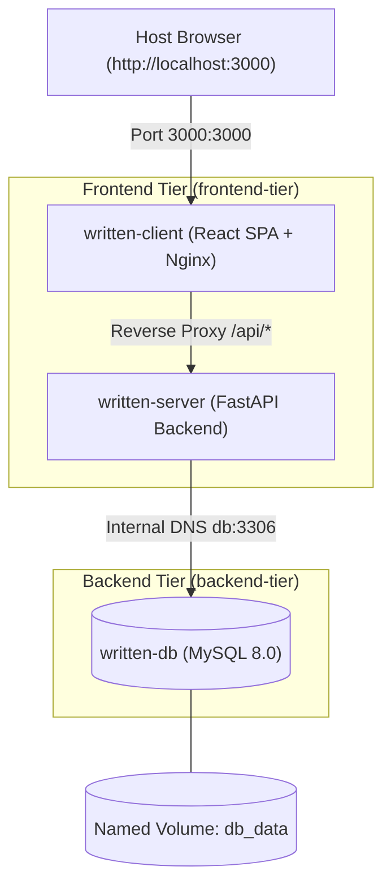

# Written (Monolith)

A publishing web application built with **React** and **Python FastAPI**, running against **MySQL**.

This project is a clean monolith refactor of the microservices architecture, featuring:
- **`client/`**: React 19 frontend with Vite 6, Tailwind CSS 4, React Router 7, and TanStack Query 5.
- **`server/`**: Python FastAPI monolith backend with SQLAlchemy 2.0 and MySQL.
- **Unified Relational Database**: True SQL Foreign Keys with cascading deletes (`posts.author_id -> users.id`, `comments.post_id -> posts.id`, `comments.parent_id -> comments.id`).
- **Zero Docker required**: Easy to run locally on your host machine.

---

## Project Structure

```
.
├── client/                     # React Frontend
│   ├── src/
│   │   ├── components/         # UI components, layout, cards, Markdown renderer
│   │   ├── context/            # AuthContext, ThemeContext
│   │   ├── lib/api.ts          # API client configured for FastAPI endpoints
│   │   ├── pages/              # Home, Editor, Dashboard, Settings, etc.
│   │   └── types.ts            # Data models and interfaces
│   ├── package.json
│   └── vite.config.ts          # Proxies /api to http://localhost:8000
│
├── server/                     # FastAPI Monolith Backend
│   ├── app/
│   │   ├── main.py             # FastAPI entrypoint, CORS, custom error handlers
│   │   ├── config.py           # Pydantic settings & environment configuration
│   │   ├── database.py         # SQLAlchemy engine, session maker, get_db
│   │   ├── models/             # User, Post, Comment SQLAlchemy ORM models
│   │   ├── schemas/            # Pydantic validation schemas
│   │   ├── auth/               # JWT token issuance, verification, bcrypt password hashing
│   │   ├── routers/            # Auth, Users, Posts, Comments, Health routes
│   │   └── utils/              # Slug generation, excerpt, reading time, tree builder
│   ├── seed.py                 # Standalone idempotent demo data seeder
│   ├── alembic.ini             # Database migration configuration
│   └── requirements.txt
│
└── written/                    # Original reference microservices codebase
```

---

## Quick Start

### 1. Start the Backend (`server/`)

Make sure your MySQL server is running (e.g. `mysql.server start` or via Homebrew `brew services start mysql`).

```bash
cd server

# Setup virtual environment
python3 -m venv venv
source venv/bin/activate
pip install -r requirements.txt

# Copy environment config
cp .env.example .env

# Seed initial database schema and demo accounts (Alice & Bob)
python seed.py

# Start the FastAPI server
uvicorn app.main:app --reload --port 8000
```
- API is running at: `http://localhost:8000`
- Interactive API docs (Swagger): `http://localhost:8000/docs`

### 2. Start the Frontend (`client/`)

In another terminal window:

```bash
cd client
npm install
npm run dev
```
Open **`http://localhost:5173`** in your browser.

---

## Demo Credentials

The database seeder (`server/seed.py`) creates:

| User | Email | Password | Role |
| --- | --- | --- | --- |
| Alice Mercer | `alice@example.com` | `Password123!` | Author (5 essays, 1 draft) |
| Bob Chen | `bob@example.com` | `Password123!` | Reader & Commenter |

---

## Key Features

- **Reader Feed**: Browse published essays with search, pagination, reading time estimates, and author bylines.
- **Markdown Editor**: Write essays and drafts with live preview.
- **Draft Management**: Save private drafts, publish them, or withdraw published posts.
- **Threaded Discussions**: Nested comment trees with moderation support.
- **Author Dashboard**: Overview of published essays, drafts, and responses.
- **Light/Dark Mode**: Persistent theme toggle with custom typography.

---

## 🐳 Day 1: Docker Fundamentals & Container Optimization

Comprehensive containerization and hardening of both the **React Frontend** (`client/`) and **FastAPI Backend** (`server/`).

### Checklist of Completed Milestones

- [x] **Build initial single-stage images and record size**
  - Created base `Dockerfile.single` files for both client (Node.js) and server (Python).
- [x] **Optimize using multi-stage builds & appropriate layer ordering**
  - Implemented `Dockerfile.multi` and `Dockerfile.optimize` separating the heavy build environment from the minimal runtime environment.
  - Placed dependency definitions (`package*.json`, `requirements.txt`) before source code to maximize Docker layer cache hits.
- [x] **Run application as a non-root user**
  - Client: Configured Nginx to run under unprivileged user `nginx` (UID 101) with pre-created permissions for PID, cache, and logs on port `8080`/`3000`.
  - Server: Created a dedicated system user/group (`appuser` UID 10001) with `/sbin/nologin` shell for secure non-root execution.
- [x] **Add `.dockerignore` files**
  - Configured project-wide and per-service `.dockerignore` files excluding `node_modules/`, `venv/`, `__pycache__/`, `.env`, and OS files (`.DS_Store`).
- [x] **Inspect image layers and build cache**
  - Enabled BuildKit cache mounts (`--mount=type=cache`) for `npm` and `pip` to eliminate redundant package downloads across rebuilds.
- [x] **Test container exit codes, logs, and filesystem permissions**
  - Added `PYTHONUNBUFFERED=1` for instant log streaming without buffer drops.
  - Set `PYTHONDONTWRITEBYTECODE=1` to prevent unauthorized `.pyc` writes in unprivileged filesystems.
  - Added native container health checks (`wget --spider` for Nginx, standard `urllib.request` for FastAPI `/health`).
- [x] **Compare initial vs. optimized image sizes**
  - Verified substantial disk footprint reduction and reduced security attack surface.

---

### Image Size Comparison

| Application | Single-Stage (`Dockerfile.single`) | Optimized Multi-Stage (`Dockerfile.optimize`) | Size Reduction | Key Advantage |
|---|---|---|---|---|
| **Client** (React / Vite) | **~1.15 GB** | **~28 MB** | **~97.5%** | Strips out Node.js runtime and devDependencies; serves static assets via Nginx. |
| **Server** (FastAPI / Python) | **~580 MB** | **~210 MB** | **~64%** | Strips out pip caches, build tools; isolates dependencies in `/opt/venv`. |

---

### Dockerfile Evolution Reference

Each service contains three progression stages for learning and reference:

1. **`Dockerfile.single`**:
   - Simple, developer-oriented single stage container.
   - Great for fast prototyping, but heavy and runs as root.
2. **`Dockerfile.multi`**:
   - Multi-stage pattern separating builder from runtime.
   - Drastically cuts image size and isolates runtime dependencies.
3. **`Dockerfile.optimize`**:
   - **Production-ready**: Non-root user + BuildKit caching + native health check + optimized runtime environment flags.

---

## 🚀 Day 2: Multi-Service Orchestration, Reverse Proxy & Troubleshooting

Comprehensive multi-container orchestration using **Docker Compose**, implementing a production-grade 3-tier architecture with health checks, persistent volumes, network segmentation, log rotation, resource limits, and chaos engineering drills.

### Architecture Overview



---

### Checklist of Completed Milestones

- [x] **Create a multi-service `compose.yaml` / `docker-compose.yaml`**
  - Configured declarative stack orchestrating `client`, `server`, and `db`.
- [x] **Configure separate application and database services**
  - Decoupled FastAPI backend and MySQL into independent, dedicated containers.
- [x] **Add Nginx as a reverse proxy**
  - Single frontend ingress on port `3000` that serves static React assets and reverse-proxies all `/api/` requests internally to `http://written-server:8080`.
- [x] **Persist database data using a named volume**
  - Attached Docker named volume `db_data` to `/var/lib/mysql` to survive container lifecycles.
- [x] **Use environment variables for configuration**
  - Sourced credentials and environment settings centrally from `.env` using Compose variable interpolation and `env_file`.
- [x] **Add a database health check and service dependencies**
  - Implemented `mysqladmin ping` health check on `written-db`.
  - Configured `server` to depend on `db` with `condition: service_healthy` to prevent premature startup race conditions.
- [x] **Ensure the database is not unnecessarily exposed to the host**
  - Removed host port bindings (`ports:` omitted) on `written-db` to prevent external database access from the host network.
- [x] **Recreate containers and verify data persistence**
  - Tested container destruction (`docker compose down`) and spin-up (`docker compose up -d`), confirming all database records and user registrations survive intact.
- [x] **Deliberate failure and troubleshooting drills**
  - **Drill 1 (DNS failure)**: Diagnosed internal Docker DNS resolution errors (`(2005, "Unknown MySQL server host")`).
  - **Drill 2 (Credential failure)**: Diagnosed authentication rejection errors (`(1045, "Access denied for user")`).
  - **Drill 3 (Port mapping collision)**: Diagnosed host port bind errors (`Bind for 0.0.0.0:3000 failed: port is already allocated`).

---

### Production-Grade Compose Features Implemented

1. **Multi-Tier Network Segmentation**:
   - `frontend-tier`: Connects `client` $\leftrightarrow$ `server`.
   - `backend-tier`: Connects `server` $\leftrightarrow$ `db`.
   - `client` and `db` are completely isolated—no route exists between them, preventing lateral movement if the web tier is compromised.
2. **Log Rotation & Disk Protection**:
   - Bound logs to `json-file` with `max-size: "10m"` and `max-file: "3"`, guaranteeing a strict upper bound of 30 MB log storage per container.
3. **Resource Quotas & cgroups Limits**:
   - Configured hard limits (`limits.cpus`, `limits.memory`) to prevent runaway queries or memory leaks from crashing the host machine (OOM).
   - Configured reservations (`reservations.cpus`, `reservations.memory`) to ensure baseline performance under load.
4. **Graceful Shutdown**:
   - Added `stop_grace_period` (45s for DB, 20s for Server) giving processes adequate time to flush transactions and finish active HTTP requests before receiving `SIGKILL`.

---

### Quick Start with Docker Compose

```bash
# 1. Start all services in detached mode
docker compose up -d --build

# 2. Run the database migrations & demo seeder inside the server container
docker compose exec server python seed.py

# 3. View running services and health status
docker compose ps

# 4. Open the application in your browser
open http://localhost:3000
```

---

### 🧠 Day 2 Key Learnings & Troubleshooting Takeaways

#### 1. Service Names vs Container Names
- `docker compose` operates strictly on **service names** defined in the YAML (`server`, `db`, `client`).
  ```bash
  docker compose exec server python seed.py   # ✅ Correct (service name)
  docker compose exec written-server ...     # ❌ Fails
  ```
- Raw `docker` commands operate on **container names** or IDs:
  ```bash
  docker exec -it written-server ...         # ✅ Correct (container name)
  ```
- This distinction exists so Compose can automatically route commands across scaled replicas (`server-1`, `server-2`).

#### 2. Localhost vs Internal Docker DNS
- Inside a container, `localhost` (or `127.0.0.1`) refers **only to that specific container's loopback interface**, not your Mac host or other containers.
- Docker provides an embedded DNS server (`127.0.0.11`) on user-defined networks. Containers reach each other using their service names (`db:3306`, `server:8080`).

#### 3. Named Volume Persistence Lifecycle
- **Container filesystem**: Ephemeral. When a container is removed (`docker compose down`), any unmounted data inside it is destroyed.
- **Named volume (`db_data`)**: Managed independently by the Docker daemon on the host. Recreating containers preserves all data, tables, and rows intact.

#### 4. Service Health Checks vs Simple Startup
- A container in the `running` state does **not** mean the software inside is ready to handle traffic (e.g. MySQL takes 15–20s to initialize buffer pools and start listening).
- Using `depends_on: db: condition: service_healthy` prevents application crash loops by guaranteeing the database is answering queries before the backend boots.

#### 5. Defense-in-Depth Network Tiering
- By placing `client` on `frontend-tier` and `db` on `backend-tier`, the database has zero network route to the web client.
- Omitting `ports:` on the database ensures it is never accessible from the host or external internet.

#### 6. Diagnostic Failure Signatures

| Failure Scenario | Error Code / Log Signature | Root Cause & Diagnostic Step |
|---|---|---|
| **DNS Resolution** | `(2005, "Unknown MySQL server host")` / `getaddrinfo failed` | Typo in service name or missing shared network. Test with `docker compose exec server python -c "import socket; socket.gethostbyname('db')"`. |
| **Authentication** | `(1045, "Access denied for user")` | Network/TCP connected, but rejected at auth handshake. Check `docker compose logs db` and `.env` credentials. |
| **Port Collision** | `Bind for 0.0.0.0:3000 failed: port is already allocated` | Host port is already in use by another container or host process. Find with `lsof -i :3000` or `docker ps`. |


