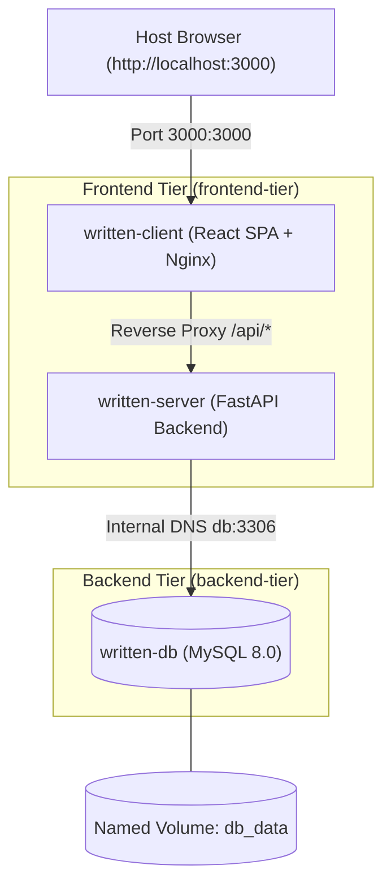
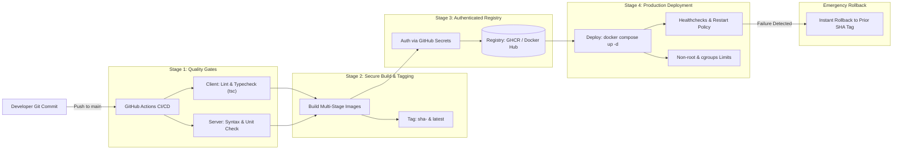

# Written (Monolith)

A publishing web application built with **React** and **Python FastAPI**, running against **MySQL**.

This project is a clean monolith refactor of the microservices architecture, featuring:
- **`client/`**: React 19 frontend with Vite 6, Tailwind CSS 4, React Router 7, and TanStack Query 5.
- **`server/`**: Python FastAPI monolith backend with SQLAlchemy 2.0 and MySQL.
- **Unified Relational Database**: True SQL Foreign Keys with cascading deletes (`posts.author_id -> users.id`, `comments.post_id -> posts.id`, `comments.parent_id -> comments.id`).
- **Zero Docker required**: Easy to run locally on your host machine.

---

## Project Structure

```
.
├── client/                     # React Frontend
│   ├── src/
│   │   ├── components/         # UI components, layout, cards, Markdown renderer
│   │   ├── context/            # AuthContext, ThemeContext
│   │   ├── lib/api.ts          # API client configured for FastAPI endpoints
│   │   ├── pages/              # Home, Editor, Dashboard, Settings, etc.
│   │   └── types.ts            # Data models and interfaces
│   ├── package.json
│   └── vite.config.ts          # Proxies /api to http://localhost:8000
│
├── server/                     # FastAPI Monolith Backend
│   ├── app/
│   │   ├── main.py             # FastAPI entrypoint, CORS, custom error handlers
│   │   ├── config.py           # Pydantic settings & environment configuration
│   │   ├── database.py         # SQLAlchemy engine, session maker, get_db
│   │   ├── models/             # User, Post, Comment SQLAlchemy ORM models
│   │   ├── schemas/            # Pydantic validation schemas
│   │   ├── auth/               # JWT token issuance, verification, bcrypt password hashing
│   │   ├── routers/            # Auth, Users, Posts, Comments, Health routes
│   │   └── utils/              # Slug generation, excerpt, reading time, tree builder
│   ├── seed.py                 # Standalone idempotent demo data seeder
│   ├── alembic.ini             # Database migration configuration
│   └── requirements.txt
│
└── written/                    # Original reference microservices codebase
```

---

## Quick Start

### 1. Start the Backend (`server/`)

Make sure your MySQL server is running (e.g. `mysql.server start` or via Homebrew `brew services start mysql`).

```bash
cd server

# Setup virtual environment
python3 -m venv venv
source venv/bin/activate
pip install -r requirements.txt

# Copy environment config
cp .env.example .env

# Seed initial database schema and demo accounts (Alice & Bob)
python seed.py

# Start the FastAPI server
uvicorn app.main:app --reload --port 8000
```
- API is running at: `http://localhost:8000`
- Interactive API docs (Swagger): `http://localhost:8000/docs`

### 2. Start the Frontend (`client/`)

In another terminal window:

```bash
cd client
npm install
npm run dev
```
Open **`http://localhost:5173`** in your browser.

---

## Demo Credentials

The database seeder (`server/seed.py`) creates:

| User | Email | Password | Role |
| --- | --- | --- | --- |
| Alice Mercer | `alice@example.com` | `Password123!` | Author (5 essays, 1 draft) |
| Bob Chen | `bob@example.com` | `Password123!` | Reader & Commenter |

---

## Key Features

- **Reader Feed**: Browse published essays with search, pagination, reading time estimates, and author bylines.
- **Markdown Editor**: Write essays and drafts with live preview.
- **Draft Management**: Save private drafts, publish them, or withdraw published posts.
- **Threaded Discussions**: Nested comment trees with moderation support.
- **Author Dashboard**: Overview of published essays, drafts, and responses.
- **Light/Dark Mode**: Persistent theme toggle with custom typography.

---

## 🐳 Day 1: Docker Fundamentals & Container Optimization

Comprehensive containerization and hardening of both the **React Frontend** (`client/`) and **FastAPI Backend** (`server/`).

### Checklist of Completed Milestones

- [x] **Build initial single-stage images and record size**
  - Created base `Dockerfile.single` files for both client (Node.js) and server (Python).
- [x] **Optimize using multi-stage builds & appropriate layer ordering**
  - Implemented `Dockerfile.multi` and `Dockerfile.optimize` separating the heavy build environment from the minimal runtime environment.
  - Placed dependency definitions (`package*.json`, `requirements.txt`) before source code to maximize Docker layer cache hits.
- [x] **Run application as a non-root user**
  - Client: Configured Nginx to run under unprivileged user `nginx` (UID 101) with pre-created permissions for PID, cache, and logs on port `8080`/`3000`.
  - Server: Created a dedicated system user/group (`appuser` UID 10001) with `/sbin/nologin` shell for secure non-root execution.
- [x] **Add `.dockerignore` files**
  - Configured project-wide and per-service `.dockerignore` files excluding `node_modules/`, `venv/`, `__pycache__/`, `.env`, and OS files (`.DS_Store`).
- [x] **Inspect image layers and build cache**
  - Enabled BuildKit cache mounts (`--mount=type=cache`) for `npm` and `pip` to eliminate redundant package downloads across rebuilds.
- [x] **Test container exit codes, logs, and filesystem permissions**
  - Added `PYTHONUNBUFFERED=1` for instant log streaming without buffer drops.
  - Set `PYTHONDONTWRITEBYTECODE=1` to prevent unauthorized `.pyc` writes in unprivileged filesystems.
  - Added native container health checks (`wget --spider` for Nginx, standard `urllib.request` for FastAPI `/health`).
- [x] **Compare initial vs. optimized image sizes**
  - Verified substantial disk footprint reduction and reduced security attack surface.

---

### Image Size Comparison

| Application | Single-Stage (`Dockerfile.single`) | Optimized Multi-Stage (`Dockerfile.optimize`) | Size Reduction | Key Advantage |
|---|---|---|---|---|
| **Client** (React / Vite) | **~1.15 GB** | **~28 MB** | **~97.5%** | Strips out Node.js runtime and devDependencies; serves static assets via Nginx. |
| **Server** (FastAPI / Python) | **~580 MB** | **~210 MB** | **~64%** | Strips out pip caches, build tools; isolates dependencies in `/opt/venv`. |

---

### Dockerfile Evolution Reference

Each service contains three progression stages for learning and reference:

1. **`Dockerfile.single`**:
   - Simple, developer-oriented single stage container.
   - Great for fast prototyping, but heavy and runs as root.
2. **`Dockerfile.multi`**:
   - Multi-stage pattern separating builder from runtime.
   - Drastically cuts image size and isolates runtime dependencies.
3. **`Dockerfile.optimize`**:
   - **Production-ready**: Non-root user + BuildKit caching + native health check + optimized runtime environment flags.

---

## 🚀 Day 2: Multi-Service Orchestration, Reverse Proxy & Troubleshooting

Comprehensive multi-container orchestration using **Docker Compose**, implementing a production-grade 3-tier architecture with health checks, persistent volumes, network segmentation, log rotation, resource limits, and chaos engineering drills.

### Architecture Overview



---

### Checklist of Completed Milestones

- [x] **Create a multi-service `compose.yaml` / `docker-compose.yaml`**
  - Configured declarative stack orchestrating `client`, `server`, and `db`.
- [x] **Configure separate application and database services**
  - Decoupled FastAPI backend and MySQL into independent, dedicated containers.
- [x] **Add Nginx as a reverse proxy**
  - Single frontend ingress on port `3000` that serves static React assets and reverse-proxies all `/api/` requests internally to `http://written-server:8080`.
- [x] **Persist database data using a named volume**
  - Attached Docker named volume `db_data` to `/var/lib/mysql` to survive container lifecycles.
- [x] **Use environment variables for configuration**
  - Sourced credentials and environment settings centrally from `.env` using Compose variable interpolation and `env_file`.
- [x] **Add a database health check and service dependencies**
  - Implemented `mysqladmin ping` health check on `written-db`.
  - Configured `server` to depend on `db` with `condition: service_healthy` to prevent premature startup race conditions.
- [x] **Ensure the database is not unnecessarily exposed to the host**
  - Removed host port bindings (`ports:` omitted) on `written-db` to prevent external database access from the host network.
- [x] **Recreate containers and verify data persistence**
  - Tested container destruction (`docker compose down`) and spin-up (`docker compose up -d`), confirming all database records and user registrations survive intact.
- [x] **Deliberate failure and troubleshooting drills**
  - **Drill 1 (DNS failure)**: Diagnosed internal Docker DNS resolution errors (`(2005, "Unknown MySQL server host")`).
  - **Drill 2 (Credential failure)**: Diagnosed authentication rejection errors (`(1045, "Access denied for user")`).
  - **Drill 3 (Port mapping collision)**: Diagnosed host port bind errors (`Bind for 0.0.0.0:3000 failed: port is already allocated`).

---

### Production-Grade Compose Features Implemented

1. **Multi-Tier Network Segmentation**:
   - `frontend-tier`: Connects `client` $\leftrightarrow$ `server`.
   - `backend-tier`: Connects `server` $\leftrightarrow$ `db`.
   - `client` and `db` are completely isolated—no route exists between them, preventing lateral movement if the web tier is compromised.
2. **Log Rotation & Disk Protection**:
   - Bound logs to `json-file` with `max-size: "10m"` and `max-file: "3"`, guaranteeing a strict upper bound of 30 MB log storage per container.
3. **Resource Quotas & cgroups Limits**:
   - Configured hard limits (`limits.cpus`, `limits.memory`) to prevent runaway queries or memory leaks from crashing the host machine (OOM).
   - Configured reservations (`reservations.cpus`, `reservations.memory`) to ensure baseline performance under load.
4. **Graceful Shutdown**:
   - Added `stop_grace_period` (45s for DB, 20s for Server) giving processes adequate time to flush transactions and finish active HTTP requests before receiving `SIGKILL`.

---

### Quick Start with Docker Compose

```bash
# 1. Start all services in detached mode
docker compose up -d --build

# 2. Run the database migrations & demo seeder inside the server container
docker compose exec server python seed.py

# 3. View running services and health status
docker compose ps

# 4. Open the application in your browser
open http://localhost:3000
```

---

### 🧠 Day 2 Key Learnings & Troubleshooting Takeaways

#### 1. Service Names vs Container Names
- `docker compose` operates strictly on **service names** defined in the YAML (`server`, `db`, `client`).
  ```bash
  docker compose exec server python seed.py   # ✅ Correct (service name)
  docker compose exec written-server ...     # ❌ Fails
  ```
- Raw `docker` commands operate on **container names** or IDs:
  ```bash
  docker exec -it written-server ...         # ✅ Correct (container name)
  ```
- This distinction exists so Compose can automatically route commands across scaled replicas (`server-1`, `server-2`).

#### 2. Localhost vs Internal Docker DNS
- Inside a container, `localhost` (or `127.0.0.1`) refers **only to that specific container's loopback interface**, not your Mac host or other containers.
- Docker provides an embedded DNS server (`127.0.0.11`) on user-defined networks. Containers reach each other using their service names (`db:3306`, `server:8080`).

#### 3. Named Volume Persistence Lifecycle
- **Container filesystem**: Ephemeral. When a container is removed (`docker compose down`), any unmounted data inside it is destroyed.
- **Named volume (`db_data`)**: Managed independently by the Docker daemon on the host. Recreating containers preserves all data, tables, and rows intact.

#### 4. Service Health Checks vs Simple Startup
- A container in the `running` state does **not** mean the software inside is ready to handle traffic (e.g. MySQL takes 15–20s to initialize buffer pools and start listening).
- Using `depends_on: db: condition: service_healthy` prevents application crash loops by guaranteeing the database is answering queries before the backend boots.

#### 5. Defense-in-Depth Network Tiering
- By placing `client` on `frontend-tier` and `db` on `backend-tier`, the database has zero network route to the web client.
- Omitting `ports:` on the database ensures it is never accessible from the host or external internet.

#### 6. Diagnostic Failure Signatures

| Failure Scenario | Error Code / Log Signature | Root Cause & Diagnostic Step |
|---|---|---|
| **DNS Resolution** | `(2005, "Unknown MySQL server host")` / `getaddrinfo failed` | Typo in service name or missing shared network. Test with `docker compose exec server python -c "import socket; socket.gethostbyname('db')"`. |
| **Authentication** | `(1045, "Access denied for user")` | Network/TCP connected, but rejected at auth handshake. Check `docker compose logs db` and `.env` credentials. |
| **Port Collision** | `Bind for 0.0.0.0:3000 failed: port is already allocated` | Host port is already in use by another container or host process. Find with `lsof -i :3000` or `docker ps`. |

---

## 🛡️ Day 3: CI/CD Automation, Security Hardening, Observability & Rollback Strategy

The final milestone shifts focus from local multi-container development to **production-grade lifecycle management**: automated CI/CD builds, immutable image tagging, secrets management, least-privilege security hardening, health observability, chaos troubleshooting, and deterministic rollbacks.

### Architecture: Continuous Delivery & Deployment Pipeline



---

### Checklist of Completed Milestones

- [x] **Tag images with a commit SHA rather than relying only on `latest`**
  - Eliminated the non-deterministic `:latest` anti-pattern.
  - Implemented immutable short Git commit SHA tagging (`sha-<commit-sha>`) alongside pointer tags.
  - Parameterized `docker-compose.yaml` with dynamic `${IMAGE_TAG:-latest}` and `${IMAGE_REGISTRY}`.
- [x] **Authenticate to Docker Hub or another registry using GitHub Actions secrets**
  - Configured secure authentication via `docker/login-action@v3` supporting GitHub Container Registry (`ghcr.io` via `GITHUB_TOKEN`) and Docker Hub (`secrets.DOCKERHUB_USERNAME`, `secrets.DOCKERHUB_TOKEN`).
  - Enforced zero-plain-text credentials policy across version control.
- [x] **Publish the image only when the relevant checks pass**
  - Created `.github/workflows/ci-cd.yml` with strict dependency stages (`needs: [verify-client, verify-server]`).
  - Gated image pushes so build artifacts are only pushed on successful checks and merge to `main`.
- [x] **Configure a health check and restart policy**
  - Adopted `restart: unless-stopped` across all services to ensure resilience against server reboots while respecting deliberate administrative stops.
  - Configured interval, timeout, retries, and start periods for application, reverse-proxy, and database containers.
  - Orchestrated startup order via `depends_on: condition: service_healthy`.
- [x] **Run the container with restricted privileges and appropriate resource limits**
  - Enforced defense-in-depth: non-root execution (`appuser:10001` and `nginx:101`).
  - Blocked privilege escalation with `security_opt: [no-new-privileges:true]`.
  - Bounded memory and CPU via cgroups (`limits` and `reservations`) to prevent host-level OOM panics.
- [x] **Simulate a failed deployment and investigate the logs**
  - Executed deliberate failure scenarios: crashing entrypoint, failing health checks, and unhandled database network dropouts.
  - Mastered targeted container diagnostics using `docker inspect`, `docker logs --tail`, and exit code analysis.
- [x] **Document a rollback procedure using the previous image tag**
  - Established a zero-rebuild rollback runbook capable of restoring service stability in seconds via pinned Git SHA image tags.

---

### Deep Dive: Production Concepts & Best Practices

#### 1. Why `:latest` is an Anti-Pattern in Production

| Dimension | `:latest` Tag | Immutable Commit SHA (`sha-a1b2c3d`) |
|---|---|---|
| **Determinism** | **Non-deterministic**: points to whatever was pushed last. | **100% Deterministic**: points to an exact git commit. |
| **Auditability** | Cannot know what source code is running inside the container. | Direct 1-to-1 mapping to the Git commit history. |
| **Rollback Speed** | Impossible to rollback without rebuilding or guessing. | **Instantaneous**: simply update the tag variable and restart. |
| **Docker Cache** | Nodes may skip pulling because the tag name hasn't changed. | Nodes always pull new layer blobs because the tag is unique. |

##### Tagging Example:
```bash
# Extract short git commit SHA locally
COMMIT_SHA=$(git rev-parse --short HEAD)

# Build and tag with both SHA and latest
docker build -t my-app:${COMMIT_SHA} -t my-app:latest ./server -f server/Dockerfile.optimize
```

---

#### 2. GitHub Actions Secrets & Multi-Registry Auth

In `.github/workflows/ci-cd.yml`, secrets must never be hard-coded into repository files:

- **Docker Hub Setup**:
  1. Generate a Personal Access Token (PAT) at Docker Hub $\rightarrow$ Account Settings $\rightarrow$ Security $\rightarrow$ New Access Token (Read & Write).
  2. In GitHub: Repository Settings $\rightarrow$ Secrets and variables $\rightarrow$ Actions $\rightarrow$ New repository secret:
     - `DOCKERHUB_USERNAME`: your Docker Hub username
     - `DOCKERHUB_TOKEN`: your generated Personal Access Token

- **GitHub Container Registry (`ghcr.io`)**:
  - Automatically authenticated using the runner's built-in `${{ secrets.GITHUB_TOKEN }}`:
  ```yaml
  - name: Log in to Registry
    uses: docker/login-action@v3
    with:
      registry: ghcr.io
      username: ${{ github.actor }}
      password: ${{ secrets.GITHUB_TOKEN }}
  ```

---

#### 3. Staged Quality Gates (Fail Fast Before Building)

Container image building and pushing is resource-heavy and slow. A quality CI/CD pipeline enforces **Fail-Fast** stages:

```
[Lint & Typecheck] ───┐
                      ├──> [Pass?] ──> [Docker Build & Test] ──> [Publish to Registry]
[Unit & Syntax Check] ┘       │
                              └──> [Fail?] ──> Pipeline Aborts Immediately (No Push)
```

In `.github/workflows/ci-cd.yml`, this is declared with `needs`:
```yaml
build-and-publish:
  needs: [verify-client, verify-server]
  if: github.ref == 'refs/heads/main'
```

---

#### 4. Restart Policies: Comparison & Selection

| Policy | Behavior on Failure | Behavior on Clean Exit | Behavior on Host Reboot | Best Use Case |
|---|---|---|---|---|
| `no` | Never restarts. | Never restarts. | Does not restart. | One-off CLI tasks, seed scripts, batch migrations. |
| `on-failure[:max]` | Restarts only if exit code $\neq 0$. | Does not restart. | Restarts only if it was failing before shutdown. | Ephemeral background workers, processing queues. |
| `always` | Restarts immediately. | Restarts immediately. | Always restarts (even if manually stopped). | Simple setups, but restarts even when stopped intentionally. |
| `unless-stopped` | **Restarts immediately.** | **Restarts immediately.** | **Restarts unless manually stopped before reboot.** | **Production Services** (recommended default). |

---

#### 5. Defense-in-Depth Container Hardening

Hardening containers minimizes the blast radius if an application dependency is exploited:

1. **Non-Root Execution**:
   - Containers run as unprivileged users (`appuser` UID 10001, `nginx` UID 101).
   - Even if remote code execution (RCE) occurs, the attacker cannot modify host-mounted files or install OS packages.
2. **Preventing Privilege Escalation**:
   ```yaml
   security_opt:
     - no-new-privileges:true
   ```
   Prevents child processes from gaining more privileges than their parent (disables `setuid`/`setgid` binaries like `sudo` or `su`).
3. **Restricting Linux Capabilities**:
   ```yaml
   cap_drop:
     - ALL
   ```
   Drops all kernel capabilities (e.g., raw network sockets, mounting filesystems, kernel tracing).
4. **Resource Quotas (cgroups v2)**:
   ```yaml
   deploy:
     resources:
       limits:
         cpus: "1.0"
         memory: 512M
   ```
   Guarantees that a memory leak in FastAPI or Node cannot starve the host system or trigger the Linux kernel Out-Of-Memory (OOM) killer against other services.

---

### 🧪 Hands-On Drills: Deployment Failure & Rollback Runbook

#### Drill A: Diagnosing an Unhealthy Container

1. **Simulate a Broken Health Check**:
   Change the backend healthcheck target to a nonexistent endpoint (`http://localhost:8080/nonexistent`) or simulate a hang.
2. **Observe Container Status**:
   ```bash
   docker compose ps
   ```
   *Output shows:*
   ```text
   NAME             IMAGE                 STATUS                     PORTS
   written-server   written-server:test   Up 35 seconds (unhealthy)  8080/tcp
   written-client   written-client:test   Up 40 seconds (healthy)    0.0.0.0:3000->3000/tcp
   ```
3. **Inspect the Exact Health Log History**:
   ```bash
   docker inspect --format='{{json .State.Health}}' written-server | jq
   ```
   *Reveals exact exit code, stdout/stderr, and HTTP 404 response received during the check.*

---

#### Drill B: Diagnosing a Crash on Startup (Exit Code Triage)

1. **Simulate a Fatal Crash**:
   Pass an invalid environment configuration (e.g. `PORT=invalid` or corrupt `DATABASE_URL`).
2. **Check Container Exit Code**:
   ```bash
   docker ps -a --filter "name=written-server" --format "table {{.Names}}\t{{.Status}}"
   ```
   *Output shows:*
   ```text
   written-server   Exited (1) 4 seconds ago
   ```
3. **Triage Logs without Running Container**:
   ```bash
   docker logs --tail 50 written-server
   ```
4. **Common Container Exit Codes**:

| Exit Code | Meaning | Common Cause |
|---|---|---|
| **0** | Clean Exit | Process finished its task successfully (e.g. migration script). |
| **1** | Application Error | Unhandled Python exception, invalid syntax, or missing env variable. |
| **127** | Command Not Found | The `CMD` or `ENTRYPOINT` binary does not exist inside the image. |
| **137** | `SIGKILL` (Fatal) | Container was killed by Docker (`docker stop`) or **OOM Killer** (exceeded memory limit). |
| **139** | Segmentation Fault | Memory corruption or binary incompatibility with the base OS image. |
| **143** | `SIGTERM` | Graceful shutdown requested by host or orchestrator. |

---

### 🔄 Production Rollback Procedure

When a bad release (`sha-badcommit`) is deployed and breaks production, rollback to the previous stable release (`sha-goodcommit`) in **under 30 seconds** without rebuilding:

```bash
# -----------------------------------------------------------------------------
# STEP 1: Identify the previous stable Commit SHA
# -----------------------------------------------------------------------------
# Option A: From Git commit log
git log -n 5 --oneline

# Option B: From your container registry tag history
# (e.g. previous tag: sha-7a8f9b2)

# -----------------------------------------------------------------------------
# STEP 2: Deploy the previous image tag via environment override
# -----------------------------------------------------------------------------
export IMAGE_TAG=sha-7a8f9b2
docker compose pull server client    # Pull pre-built tested images from registry
docker compose up -d                 # Recreate containers with previous image tag

# -----------------------------------------------------------------------------
# STEP 3: Verify system restoration & health
# -----------------------------------------------------------------------------
docker compose ps
docker compose logs --tail 20 server client
curl -I http://localhost:3000/api/health

# -----------------------------------------------------------------------------
# STEP 4: Persist the rollback in Git (Revert the faulty commit)
# -----------------------------------------------------------------------------
git revert HEAD --no-edit
git push origin main
```


